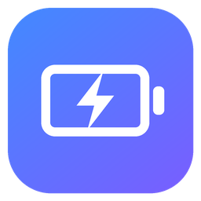
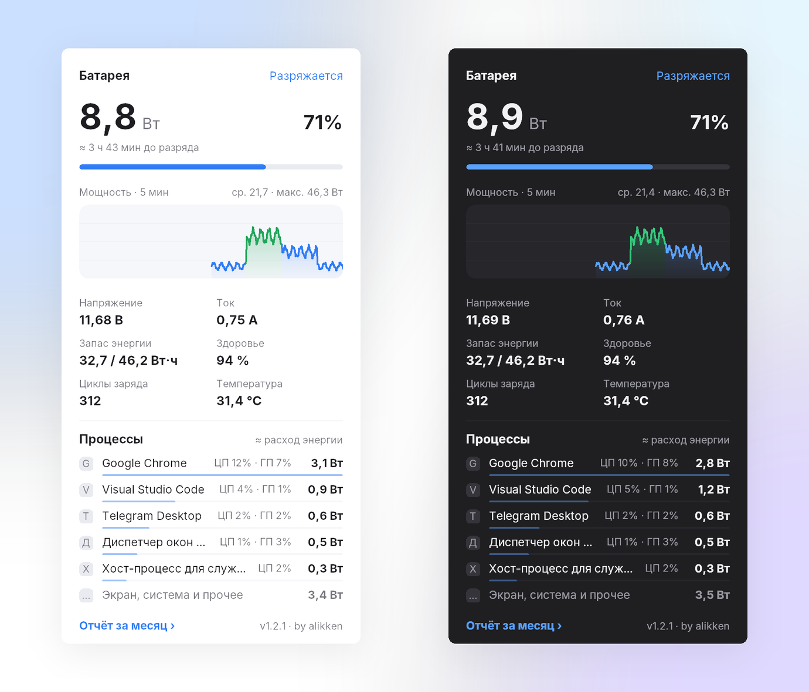
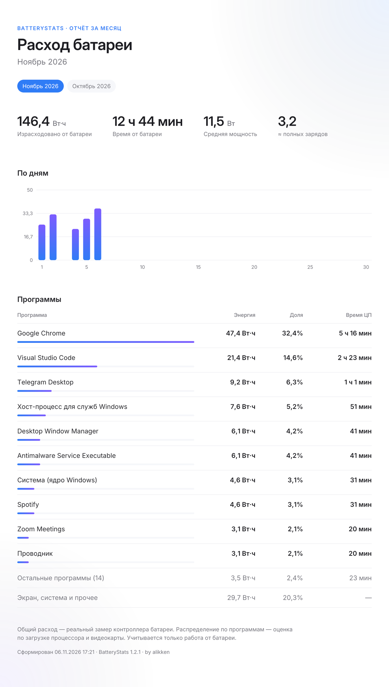
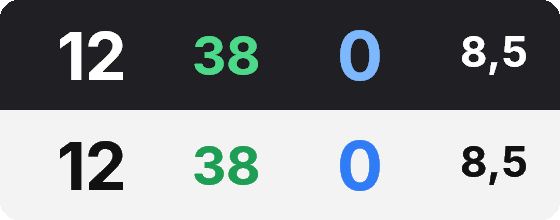
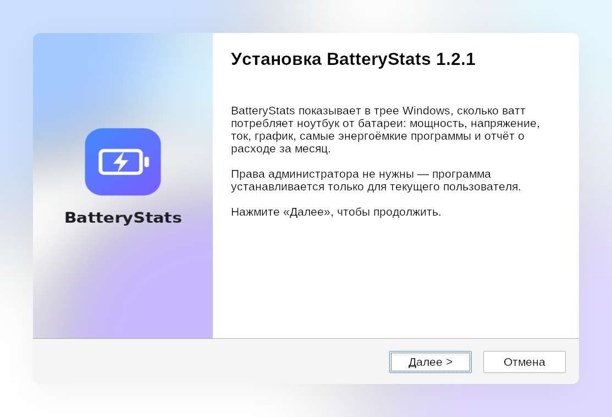

<p align="center">
  
</p>

<h1 align="center">BatteryStats</h1>

<p align="center">
  Сколько ватт ест ноутбук прямо сейчас и на какие программы уходит батарея.<br>
  Монитор батареи для Windows 10 и 11 · by alikken
</p>

<p align="center">
  
  
  
  
</p>

<p align="center">
  
</p>

BatteryStats показывает мощность батареи в ваттах прямо в значке трея, как Stats на macOS. По клику открывается окно с графиком, деталями батареи и списком самых энергоёмких программ. Пока ноутбук работает от батареи, приложение собирает статистику и строит отчёт за месяц: сколько энергии ушло и какие программы съели больше всего.

Один exe около 650 КБ без зависимостей. Права администратора не нужны, в интернет приложение не ходит.

## Возможности

- **Ватты в трее.** Цифра обновляется каждую секунду. Цвет показывает режим: белый — разряд, зелёный — зарядка, синий — от сети. Вместо ватт можно показывать процент заряда.
- **Окно с деталями.** Мощность, процент, время до разряда или до полной зарядки, график за 5 минут, напряжение, ток, запас энергии, здоровье, циклы, температура (если батарея её отдаёт).
- **Процессы.** Загрузка ЦП и видеокарты по каждой программе и примерный расход в ваттах.
- **Отчёт за месяц.** Итог в Вт·ч, время от батареи, средняя мощность, график по дням, топ программ, прошлые месяцы.
- **Три языка:** русский, английский, польский. По умолчанию как в Windows, переключается в меню.
- **Светлая и тёмная тема**, корректный вид при любом масштабе экрана (Per-Monitor DPI v2).
- **Установщик** на тех же трёх языках, ставит программу без UAC и удаляется через «Параметры → Приложения».

## Скриншоты

| Отчёт за месяц | Значки в трее |
|---|---|
|  | <br><br>Разряд · зарядка · от сети · до 10 Вт с десятыми.<br>Сверху тёмная панель задач, снизу светлая. |

<p align="center"></p>

Скриншоты сняты в демо-режиме (`BatteryStats.exe --demo`) на тестовых данных.

## Установка

1. Скачайте `BatteryStats-Setup-<версия>.exe` в разделе [Releases](../../releases).
2. Запустите установщик. Права администратора не нужны: программа ставится в `%LOCALAPPDATA%\Programs\BatteryStats`.
3. Значок появится в трее у часов. Если его не видно, нажмите стрелку `^` и перетащите значок на панель задач.

Без установки: скачайте `BatteryStats.exe` из того же релиза и просто запустите.

Оба файла текущей версии также лежат в папке [`release/`](release).

Установщик и программа пока не подписаны сертификатом. При запуске файла, скачанного из интернета, Windows покажет «Windows защитила ваш компьютер»: нажмите «Подробнее» → «Выполнить в любом случае».

**Требования:** Windows 10 или 11, 64-бит, ноутбук с батареей.

## Как это работает

| Что | Откуда | Точность |
|---|---|---|
| Мощность, напряжение, ток, ёмкость, циклы | Драйвер батареи Windows (`IOCTL_BATTERY_QUERY_STATUS` / `_INFORMATION`) — тот же источник, что у системы | Реальный замер контроллера батареи |
| Расход за месяц (Вт·ч) | Интеграл реальной мощности разряда по времени | Реальный замер |
| Ватты по программам | Счётчики производительности Windows (PDH): `% Processor Time` и `GPU Engine` | **Оценка** |

Отдельного датчика энергии на программу у ноутбука нет: контроллер меряет ток всей батареи. Поэтому мощность разряда делится между программами пропорционально нагрузке:

```
Вт_программы ≈ Вт_батареи × (ЦП% + 0,5 × ГП%) / (Σ нагрузки + 15)
```

Слагаемое 15 — доля экрана, Wi-Fi, чипсета и простоя, в списке это «Экран, система и прочее». Так же поступают и системные инструменты: столбец «Энергопотребление» в диспетчере задач и «Энергетическое воздействие» в macOS — тоже расчётные.

Ватты по программам считаются только при работе от батареи. От сети показывается доля нагрузки в процентах.

**Расход ресурсов.** Пока окно закрыто, батарея опрашивается раз в 1–5 секунд, а процессы — раз в 10 секунд и только при работе от батареи. От сети процессы не опрашиваются вовсе.

## Данные и настройки

Всё хранится локально, приложение не делает сетевых запросов.

| Что | Где |
|---|---|
| Статистика по месяцам | `%LOCALAPPDATA%\BatteryStats\usage-ГГГГ-ММ.tsv` |
| HTML-отчёты | `%LOCALAPPDATA%\BatteryStats\reports\` |
| Настройки (язык, интервал, режим значка) | `HKCU\Software\BatteryStats` |
| Автозапуск (если включён) | `HKCU\Software\Microsoft\Windows\CurrentVersion\Run` |

Статистика сохраняется раз в 5 минут, а также при выходе, уходе в сон и выключении Windows. Формат простой (TSV), его можно открыть в Excel.

Меню по правому клику на значке: подробнее, отчёты (по месяцам) и папка с данными, что показывать в значке, частота обновления, язык, автозапуск, выход.

## Удаление

«Параметры → Приложения → BatteryStats → Удалить». Удаляются программа, ярлыки, автозапуск и настройки. Собранную статистику установщик предлагает удалить или оставить.

## Сборка из исходников

Проект собирается кросс-компиляцией под `x86_64-pc-windows-gnu`. Проверено на Linux (подойдёт и WSL):

```bash
sudo apt install mingw-w64 nsis
rustup target add x86_64-pc-windows-gnu
./build.sh          # → dist/BatteryStats.exe и dist/BatteryStats-Setup-<версия>.exe
```

Версия задаётся в одном месте — `Cargo.toml`. Она попадает в свойства exe, интерфейс, установщик и список приложений Windows.

Режимы для разработки:

```bash
BatteryStats.exe --demo                       # тестовые данные, отдельная папка BatteryStats-demo
cargo build --release --features devtools     # добавляет --icon-dump <папка> и --report-test <папка>
```

## Структура

```
src/
  main.rs      трей, меню, окна, потоки опроса, учёт энергии
  battery.rs   чтение батареи через IOCTL драйвера
  procs.rs     нагрузка процессов (PDH), имена и иконки программ
  popup.rs     отрисовка окна (GDI + GDI+)
  icon.rs      рендер числа в значок трея
  usage.rs     хранение месячной статистики
  report.rs    HTML-отчёт
  i18n.rs      строки на трёх языках
  util.rs      реестр, форматирование, пути
res/           иконка, манифест, VERSIONINFO, картинки установщика
installer/     сценарий установщика (NSIS)
```

## Лицензия

[MIT](LICENSE) © 2026 alikken

---

### English

BatteryStats is a Windows 10/11 tray app that shows how many watts your laptop draws from the battery, like Stats on macOS. Click the icon for a live chart, voltage, current, energy left, battery health and the most power-hungry apps. While on battery it logs usage and builds a monthly HTML report with per-day totals and top apps. UI in English, Russian and Polish. Single ~650 KB exe, no admin rights, no network access.

Battery figures come straight from the Windows battery driver. Per-app watts are an estimate: real discharge power split by each app's CPU and GPU load. Download the installer from [Releases](../../releases). MIT licensed.
